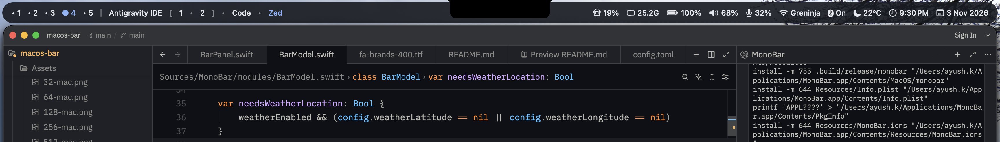

<p align="center">
  
</p>

<h1 align="center">MonoBar</h1>

A native AppKit status bar for macOS, designed for AeroSpace. It uses a borderless non-activating `NSPanel`, CoreGraphics text drawing, a small TOML configuration reader, and a Unix datagram socket for AeroSpace event callbacks.

## Build

Requires macOS 13+ and Swift 6.

### Modules: 
#### bluetooth: Bluetooth toggling uses [`blueutil`](https://github.com/toy/blueutil); install it with `brew install blueutil`.

#### weather: Weather uses the OpenWeather current weather API. Add your API key under `[weather]` in `~/.config/monobar/config.toml`. MonoBar uses current location when latitude and longitude are omitted, or you can set both coordinates to avoid location lookup. Choose `metric`, `imperial`, or `standard` units.

#### volume/mic: The `volume` and `mic` modules show the current output and input volume. Click either module to toggle mute, or scroll up and down over it to adjust that device's level.

#### wifi: Under `[wifi]`, set `wifi_ssid_masked = true` to hide the connected network name. Set `masked_ssid_name` to choose the replacement text; it defaults to `"<redacted>"` when omitted or empty.

#### vpn: The `vpn` module controls OpenVPN Connect. Set `[vpn].profile_id` to the imported profile ID and include `"vpn"` in `[layout].modules-right` if your existing config defines a custom module list. Get profile IDs with OpenVPN Connect's CLI command:
```sh
'/Applications/OpenVPN Connect/OpenVPN Connect.app/contents/MacOS/OpenVPN Connect' --list-profiles
```
Clicking the module connects or disconnects the configured profile and shows its connection state. After editing the config, press **Control+Shift+R** to reload it.

For seamless VPN module operation, configure OpenVPN Connect to minimize on launch:

```sh
'/Applications/OpenVPN Connect/OpenVPN Connect.app/contents/MacOS/OpenVPN Connect' --set-setting=minimize-on-launch --value=true
```

### Bar floating and radius config
Set `radius_top_left`, `radius_top_right`, `radius_bottom_right`, and `radius_bottom_left` in `[bar]` to configure each corner independently. Values are point radii and are clamped to half the bar's height or width.

For the four corners facing the notch, set `radius_top_left_notch`, `radius_top_right_notch`, `radius_bottom_right_notch`, and `radius_bottom_left_notch`. Each defaults to the corresponding regular corner radius and can also be overridden in a `[monitors.<profile>]` section.

Set `float = true` to keep the bar above normal app windows, or `false` to let windows cover it. `offset_top` moves the bar down from the top edge in points; the existing `offset_y` setting remains supported, and `offset_top` takes precedence when both are set.

`offset_side` sets an equal inset from the left and right screen edges and from both notch edges on notched displays. With `width = "100%"`, the bar fills the remaining width and stays centered. The existing `offset_x` remains available as an additional horizontal shift.

### Multi-monitor setup

MonoBar creates a bar on every connected display. The `[bar]` and `[layout]` sections set defaults; add a `[monitors.<profile>]` section to override geometry or modules for one display. `screen` matches a display's macOS name, `main`, or `id:<display-id>`. Unspecified properties inherit the defaults.

```toml
[monitors.laptop]
screen = "main"
height = 32
offset_top = 2
modules-left = ["workspaces", "title"]
modules-right = ["wifi", "battery", "clock"]

[monitors.external]
screen = "DELL U2723QE"
height = 40
offset_side = 12
modules-left = ["workspaces"]
modules-right = ["cpu", "ram", "clock"]
```

Display changes rebuild the bars using the matching monitor profile.

Config files support TOML `#` comments on their own lines or after a setting. A `#` inside a quoted string is kept as part of the value.

Press **Control+Shift+R** anywhere to reload `~/.config/monobar/config.toml`. The shortcut rebuilds the bars, modules, monitor profiles, and event socket using the updated settings.

### For debug builds
```sh
make build
```
The executable is present at `.build/debug/monobar`. 

### For release builds
```sh
make install
```
The executable is present at  `"$HOME/Applications/MonoBar.app"` and can be launched by 

```sh
open -a "$HOME/Applications/MonoBar.app"
```
Copy `config/config.toml` to `~/.config/monobar/config.toml`, replace the example socket path with your home path, then run the executable. `XDG_CONFIG_HOME` is also supported. Existing `MonoBar` configuration files are still read as a fallback.

## Preview

  

## AeroSpace events

See `aerospace.toml.example`; merge the hook into your AeroSpace config and reload AeroSpace. Workspace pills invoke `aerospace workspace <name>`. Each display filters workspace pills to the workspaces AeroSpace assigns to that monitor. The bar refreshes workspaces on hook events and reads the focused window title during refresh.

The implementation is intentionally compact. `music` remains an extension point. Wi-Fi, Bluetooth, audio volume, and weather use native system APIs or the configured OpenWeather provider; CPU/RAM and battery use native system APIs.
